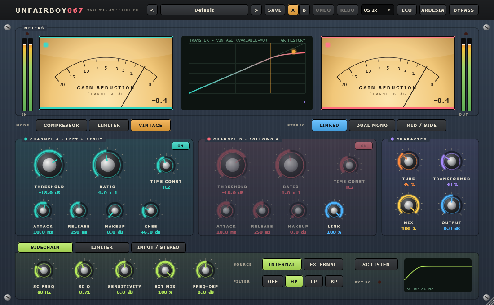

# Unfairboy 067

Variable-mu compressor / limiter plugin (VST3, Standalone; AU and AAX prepared) with a native C++20 DSP engine,
inspired by the sonic character of classic tube limiters of the 1950s–60s. It is not a circuit-level emulation.



## Features

- **Modes:** Compressor (feed-forward, soft knee), Limiter, Vintage (feedback topology, variable-mu curve whose ratio grows with level)
- **Release:** fixed, auto (program dependent), TC1–TC6 vintage time constants with multi-stage program-dependent release
- **Stereo:** Linked (adjustable link %), Dual Mono, Mid/Side with independent A/B channel controls, exact M/S width
- **Sidechain:** internal / external, HP / LP / BP filter, sensitivity, external mix, listen, frequency-dependent detection
- **Character:** tube stage (even harmonics), transformer stage (LF saturation, HF softening), optional noise and hum
- **Output:** look-ahead brick-wall limiter with true-peak detection, soft clip, latency-compensated dry/wet and bypass
- **Quality:** 1x–8x linear-phase oversampling, per-sample parameter smoothing, no allocation or locks on the audio thread
- **GUI:** vector, resizable 100–200 %, three colour themes, VU gain-reduction meters, transfer curve, GR history
- **Presets:** 17 factory presets, user presets with categories, import/export, A/B, undo/redo, copy/paste, randomize

## Build (Windows)

Requirements: Visual Studio 2022 Build Tools (C++ workload), CMake ≥ 3.25, Git. JUCE 8.0.4 and doctest are downloaded by CMake.

```powershell
.\build.ps1            # DSP library + unit tests
.\build.ps1 -Plugin    # also VST3, Standalone and the GUI snapshot tool
```

The build tree goes to `%LOCALAPPDATA%\TwinMu\build-release` (short path, avoids MAX_PATH issues).

macOS (AU/VST3): `cmake -S . -B build -G Xcode -DTWINMU_BUILD_PLUGIN=ON`. AAX: set `AAX_SDK_PATH` to Avid's SDK.

## Layout

| Path | Content |
|---|---|
| `Source/DSP` | framework-independent engine (filters, envelopes, gain computers, saturation, oversampling, limiter, engine) |
| `Tests` | 33 doctest unit/integration tests with objective measurements |
| `Plugin/Source` | JUCE processor, parameters, preset manager, GUI |
| `Plugin/Tools` | snapshot tool that renders the editor to PNG |
| `Documentation` | architecture (Phase 1), DSP test report (Phase 2), GUI mockup, screenshots |

## Status

DSP engine tested (see `Documentation/03_Fase2_Report_DSP.md`). Plugin builds without warnings on MSVC.
Not yet done: DAW compatibility testing and pluginval, sound tuning by critical listening, installer, user manual.
