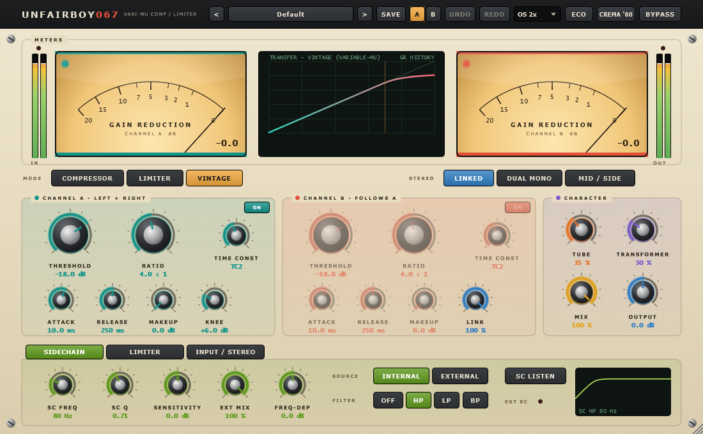
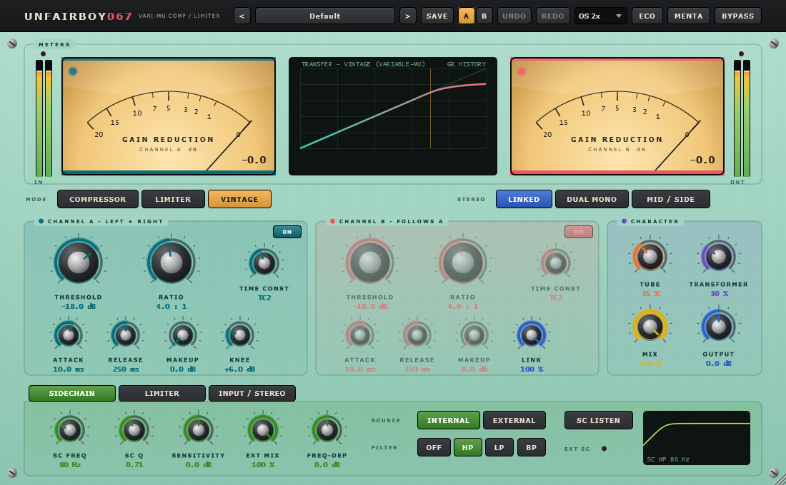

# Unfairboy 067

Variable-mu compressor / limiter plugin (VST3, Standalone; AU and AAX prepared) with a native C++20 DSP engine,
inspired by the sonic character of classic tube limiters of the 1950s–60s. It is not a circuit-level emulation.

The DSP engine (`Source/DSP`) is framework-independent and covered by its own test suite; the JUCE layer
(`Plugin/Source`) only bridges it to the host and draws the interface.


## Audio features

- **Modes:** Compressor (feed-forward, soft knee), Limiter, Vintage (feedback topology, variable-mu curve whose ratio grows with level)
- **Release:** fixed (VAR), auto (program dependent), TC1–TC6 vintage time constants with multi-stage program-dependent release
- **Stereo:** Linked (adjustable link %), Dual Mono, Mid/Side with independent A/B channel controls, exact M/S width
- **Sidechain:** internal / external, HP / LP / BP filter, sensitivity, external mix, listen, frequency-dependent detection
- **Character:** tube stage (even harmonics), transformer stage (LF saturation, HF softening), optional noise and hum
- **Output:** look-ahead brick-wall limiter with true-peak detection, soft clip, latency-compensated dry/wet and bypass
- **Quality:** 1x–8x linear-phase oversampling, per-sample parameter smoothing, no allocation or locks on the audio thread
- **I/O:** mono or stereo main bus, optional mono/stereo sidechain input bus

## Interface

A single 1100 × 680 panel, entirely vector-drawn and scaled with an affine transform, so it stays sharp on HiDPI
screens. Every knob, switch and selector is bound to a host-automatable parameter.

### Top bar

| Control | Function |
|---|---|
| `<` / preset name / `>` | Previous / next preset; clicking the name opens the preset menu (see *Presets*) |
| `SAVE` | Save the current settings as a user preset (name + category) |
| `A` / `B` | A/B comparison: two independent settings slots, switched instantly |
| `UNDO` / `REDO` | Undo history; one step per mouse gesture |
| `OS 1x … 8x` | Oversampling of the saturation stages (changes latency) |
| `ECO` | Live-use mode: forces 1x oversampling and lighter saturation |
| Theme button | Cycles the colour theme: **Ardesia**, **Crema '60**, **Menta** |
| `BYPASS` | Latency-compensated bypass (also exposed as the host bypass parameter) |

### Meters section

- **IN / OUT bar meters** — stereo peak meters (-60 … +6 dB) with peak hold and a clip LED that lights for 2 s on overs.
- **Two VU gain-reduction meters** (channel A and B) — analog-style needle with an expanded scale near 0 dB
  (0–20 dB), fast rise / slow fall ballistics and a numeric GR read-out. In Mid/Side they are labelled *GR – MID* / *GR – SIDE*;
  in Linked mode meter B follows A.
- **Transfer curve display** — the static input/output curve of the current mode, threshold, ratio and knee, computed
  with the same functions as the engine, plus a live dot showing the current working point.
- **GR history strip** — scrolling gain-reduction history under the curve (highlighted above 10 dB).

### Mode and stereo selectors

- **MODE:** `COMPRESSOR` · `LIMITER` · `VINTAGE`
- **STEREO:** `LINKED` · `DUAL MONO` · `MID / SIDE`

The channel section titles follow the stereo mode (e.g. *Channel A – Left + Right / Channel B – Follows A*,
*Left / Right*, *Mid / Side*). In Linked mode the channel B controls are dimmed and disabled and the `LINK` knob is active.

### Channel A / Channel B strips

Each strip has: `THRESHOLD`, `RATIO` (up to ∞:1; in Vintage mode it is the ratio 10 dB above threshold),
`TIME CONST` (VAR, AUTO, TC1–TC6), `ATTACK`, `RELEASE`, `MAKEUP` and an `ON` switch.
Strip A also holds the shared `KNEE` (0 dB = hard knee), strip B the `LINK` amount.

### Character section

`TUBE` (even-harmonic saturation), `TRANSFORMER` (LF saturation, HF softening), `MIX` (latency-compensated dry/wet
for parallel compression), `OUTPUT` gain.

### Bottom tabs

- **SIDECHAIN** — `SC FREQ`, `SC Q`, `SENSITIVITY`, `EXT MIX`, `FREQ-DEP` knobs; `SOURCE` (internal / external) and
  `FILTER` (off / HP / LP / BP) selectors; `SC LISTEN`; a small display of the sidechain filter response;
  an *EXT SC* LED showing whether an external key is actually connected (with a "not connected: internal" hint).
- **LIMITER** — `LIMITER` on/off, `CEILING`, `RELEASE`, `LOOKAHEAD`, `AMOUNT`, `TRUE PEAK`, `SOFT CLIP`,
  and a live limiter gain-reduction read-out.
- **INPUT / STEREO** — `INPUT` gain, `WIDTH` (0–200 %, mono compatible), `NOISE` (analog noise floor, off by default),
  `AUTO MAKEUP`, `HUM` (off / 50 Hz / 60 Hz), and the current plugin latency in samples.

### Knob handling

- Vertical drag, mouse wheel, value pop-up while dragging
- Double-click: reset to default
- Right-click: type an exact value (units understood: `ms` / `s`, `Hz` / `kHz`, `inf` for ratio)
- Tooltips on every control

### Window

- Resizable from 100 % to 200 % with fixed aspect ratio
- Window size and chosen theme are remembered between sessions

## Presets

- **17 factory presets** in categories (Vocal, Drum Bus, Kick, Snare, Bass, Master Bus, Mix Bus, Piano, Strings,
  Guitar, Synth, Live Sound, Limiting, Vintage Compression)
- **User presets** saved as `.u067preset` files in `Documents/Unfairboy 067/Presets/<category>`; user presets appear in the menu marked *(user)*
- Preset menu: load by category, Save as, Rename and Delete (user presets only, deleted to the recycle bin),
  Import / Export, Copy / Paste settings via clipboard, gentle Randomize, Open preset folder
- Randomize nudges only continuous tone parameters, leaving gain staging, mode, routing, limiter ceiling/lookahead,
  oversampling and bypass untouched; the preset name gets a `*` to mark it modified

## Build (Windows)

Requirements: Visual Studio 2022 Build Tools (C++ workload), CMake ≥ 3.25, Git. JUCE 8.0.4 and doctest are downloaded by CMake.

```powershell
.\build.ps1            # DSP library + unit tests
.\build.ps1 -Plugin    # also VST3, Standalone and the GUI snapshot tool
```

The build tree goes to `%LOCALAPPDATA%\TwinMu\build-release` (short path, avoids MAX_PATH issues).

macOS (AU/VST3): `cmake -S . -B build -G Xcode -DTWINMU_BUILD_PLUGIN=ON`. AAX: set `AAX_SDK_PATH` to Avid's SDK.

The snapshot tool (`unfairboy_snapshot <output folder>`) renders the real editor to one PNG per theme without a
host, feeding test audio so meters and curve show a working point.

## Layout

| Path | Content |
|---|---|
| `Source/DSP` | framework-independent engine (filters, envelopes, gain computers, saturation, oversampling, limiter, engine) |
| `Tests` | 33 doctest unit/integration tests with objective measurements |
| `Plugin/Source` | JUCE processor, parameters, preset manager, GUI |
| `Plugin/Tools` | snapshot tool that renders the editor to PNG |
| `Documentation` | architecture (Phase 1), DSP test report (Phase 2), GUI mockup, screenshots |

## Screenshots

| Ardesia | Crema '60 | Menta |
|---|---|---|
|  |  |  |

## Status

DSP engine tested (see `Documentation/03_Fase2_Report_DSP.md`). Plugin builds without warnings on MSVC.
Not yet done: DAW compatibility testing and pluginval, sound tuning by critical listening, installer, user manual.
